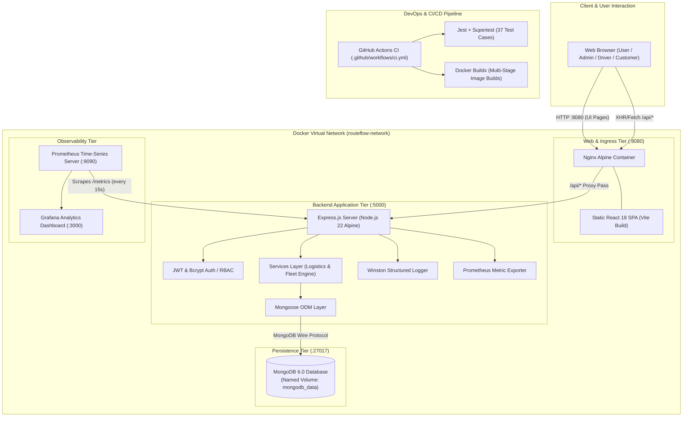
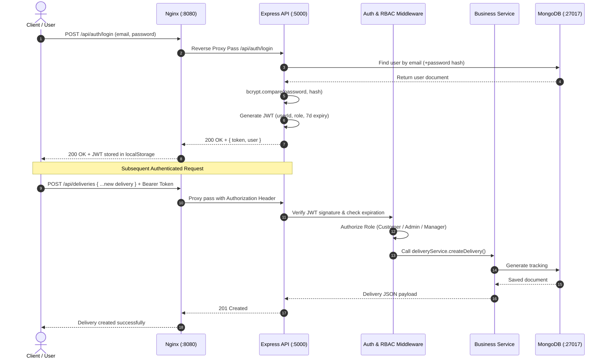

# Routeflow: Complete System Architecture & File-by-File Technical Guide

**Project:** Cloud-Based Logistics and Delivery Management System with DevOps Automation  
**Group:** 78 | **Academic Level:** Sem 5 DevOps Engineering  
**Tech Stack:** React 18, Vite, Express.js, MongoDB (Mongoose), Nginx Alpine, Docker & Docker Compose, GitHub Actions, Prometheus, Grafana, Jest & Supertest, Cypress  

---

## 1. System Architecture Overview

Routeflow is structured as a **containerized multi-tier application with a modular backend architecture**. It separates concerns across distinct decoupled tiers: Presentation, Gateway / Reverse Proxy, Application Business Logic, Data Persistence, Observability, and CI/CD Automation.

---

## 2. Request & Authentication Flow

---

## 3. Comprehensive File-by-File Breakdown

### Root Directory (Orchestration & DevOps)

| File | Purpose & Responsibilities |
|---|---|
| [docker-compose.yml](file:///c:/Users/DELL/Documents/Quick%20Share/Sem%205/DevOps/DevOps%20Project/docker-compose.yml) | Canonical full-stack multi-container orchestrator. Defines 5 interconnected services: `frontend` (port 8080), `backend` (port 5000), `mongodb` (port 27017 with persistent volume `mongodb_data`), `prometheus` (port 9090), and `grafana` (port 3000). Features automated health checks and `condition: service_healthy` startup dependency ordering. |
| [.gitignore](file:///c:/Users/DELL/Documents/Quick%20Share/Sem%205/DevOps/DevOps%20Project/.gitignore) | Comprehensive root Git ignore rules. Prevents committing `node_modules/`, `dist/`, build outputs, real credentials (`.env`), test coverage directories (`coverage/`, `.nyc_output/`), logs (`*.log`), and OS artifacts (`.DS_Store`, `Thumbs.db`). |
| [README.md](file:///c:/Users/DELL/Documents/Quick%20Share/Sem%205/DevOps/DevOps%20Project/README.md) | Central academic project documentation for **Group 78**. Summarizes business capabilities, technology stack, directory layout, one-command Docker Compose instructions, default credentials for all 4 roles, and CI/CD quality gate descriptions. |
| [.github/workflows/ci.yml](file:///c:/Users/DELL/Documents/Quick%20Share/Sem%205/DevOps/DevOps%20Project/.github/workflows/ci.yml) | GitHub Actions CI/CD configuration. Automatically executes on every push/PR to `main`, `master`, and feature branches: (1) runs backend Jest test suite with a live MongoDB service container, (2) runs `vite build` on frontend, and (3) executes Docker Buildx container verification builds for both Dockerfiles. |

---

### Backend Directory (`Back-End/`)

#### 1. Configuration & Server Core
- [Back-End/src/server.js](file:///c:/Users/DELL/Documents/Quick%20Share/Sem%205/DevOps/DevOps%20Project/Back-End/src/server.js): Entry point for Node.js runtime. Establishes MongoDB connection via `database.js`, launches the HTTP listener on `PORT` (default 5000), logs startup information via Winston, and registers graceful termination handlers (`SIGTERM`, `SIGINT`) to shut down connections cleanly.
- [Back-End/src/app.js](file:///c:/Users/DELL/Documents/Quick%20Share/Sem%205/DevOps/DevOps%20Project/Back-End/src/app.js): Express application factory. Configures global middlewares (`helmet` security headers, `cors` cross-origin sharing, `express.json` parsing, `morgan` HTTP request logging via Winston, Prometheus metrics middleware), mounts all `/api` sub-routers, and registers 404 and global error handlers.
- [Back-End/src/config/database.js](file:///c:/Users/DELL/Documents/Quick%20Share/Sem%205/DevOps/DevOps%20Project/Back-End/src/config/database.js): Mongoose connection abstraction with auto-reconnection logic, pool management, error handling, and `disconnectDatabase()` utility for clean test teardown.
- [Back-End/src/config/environment.js](file:///c:/Users/DELL/Documents/Quick%20Share/Sem%205/DevOps/DevOps%20Project/Back-End/src/config/environment.js): Centralized, validated environment configuration with fallbacks for `NODE_ENV`, `PORT`, `MONGODB_URI`, `JWT_SECRET`, `JWT_EXPIRES_IN`, `FRONTEND_ORIGIN`, and `PROMETHEUS_METRICS_ENABLED`.
- [Back-End/src/config/logger.js](file:///c:/Users/DELL/Documents/Quick%20Share/Sem%205/DevOps/DevOps%20Project/Back-End/src/config/logger.js): Winston logging configuration supporting multiple log levels (`info`, `warn`, `error`), JSON formatting in production, colorized console output in development, and optional rolling file logging in `logs/`.

#### 2. Models (MongoDB Schemas)
- [Back-End/src/models/User.js](file:///c:/Users/DELL/Documents/Quick%20Share/Sem%205/DevOps/DevOps%20Project/Back-End/src/models/User.js): User schema with fields `name`, `email` (unique index), `password` (hashed via bcrypt pre-save hook), `role` (`admin`, `manager`, `driver`, `customer`), `phone`, `organization`, and `isActive`. Provides `matchPassword()` helper method.
- [Back-End/src/models/Driver.js](file:///c:/Users/DELL/Documents/Quick%20Share/Sem%205/DevOps/DevOps%20Project/Back-End/src/models/Driver.js): Driver schema extending logistics attributes: `user` (ObjectId reference to User), `licenseNumber`, `vehicleType` (Van, Truck, Motorcycle, Electric Van), `vehicleNumber`, `status` (`available`, `on_delivery`, `off_duty`), `currentLocation`, `phone`, `rating`, and `activeDeliveriesCount`.
- [Back-End/src/models/Delivery.js](file:///c:/Users/DELL/Documents/Quick%20Share/Sem%205/DevOps/DevOps%20Project/Back-End/src/models/Delivery.js): Central logistics delivery order schema. Tracks `trackingNumber` (unique uppercase prefixed string, e.g., `RTF-2026-XXXXXX`), `customer` (ref to User), `assignedDriver` (ref to Driver), `origin`, `destination`, `recipientName`, `recipientPhone`, `packageDetails` (weight, description, priority), `status` (`pending`, `assigned`, `picked_up`, `in_transit`, `delivered`, `cancelled`, `failed`), `estimatedDelivery`, `statusHistory` timeline array, and proof-of-delivery notes.
- [Back-End/src/models/Notification.js](file:///c:/Users/DELL/Documents/Quick%20Share/Sem%205/DevOps/DevOps%20Project/Back-End/src/models/Notification.js): In-app notification schema tracking `recipient` (ref to User), `title`, `message`, `type` (`info`, `success`, `warning`, `delivery_update`), `isRead`, and optional `delivery` reference.

#### 3. Controllers & Routes
- [Back-End/src/routes/authRoutes.js](file:///c:/Users/DELL/Documents/Quick%20Share/Sem%205/DevOps/DevOps%20Project/Back-End/src/routes/authRoutes.js) / [authController.js](file:///c:/Users/DELL/Documents/Quick%20Share/Sem%205/DevOps/DevOps%20Project/Back-End/src/controllers/authController.js): Handles `/api/auth/register`, `/api/auth/login`, and `/api/auth/me`. Verifies credentials, issues JWT bearer tokens, and returns sanitized profile payloads.
- [Back-End/src/routes/deliveryRoutes.js](file:///c:/Users/DELL/Documents/Quick%20Share/Sem%205/DevOps/DevOps%20Project/Back-End/src/routes/deliveryRoutes.js) / [deliveryController.js](file:///c:/Users/DELL/Documents/Quick%20Share/Sem%205/DevOps/DevOps%20Project/Back-End/src/controllers/deliveryController.js): Complete CRUD for deliveries: `GET /api/deliveries` (filtered by role and query params), `POST /api/deliveries`, `GET /api/deliveries/:id`, `PATCH /api/deliveries/:id/status`, `PATCH /api/deliveries/:id/assign`, and `GET /api/deliveries/track/:trackingNumber`.
- [Back-End/src/routes/driverRoutes.js](file:///c:/Users/DELL/Documents/Quick%20Share/Sem%205/DevOps/DevOps%20Project/Back-End/src/routes/driverRoutes.js) / [driverController.js](file:///c:/Users/DELL/Documents/Quick%20Share/Sem%205/DevOps/DevOps%20Project/Back-End/src/controllers/driverController.js): Driver fleet endpoints: `GET /api/drivers` (list drivers with status/vehicle filters), `GET /api/drivers/:id`, `POST /api/drivers`, `PATCH /api/drivers/:id/status`, and `GET /api/drivers/:id/deliveries`.
- [Back-End/src/routes/userRoutes.js](file:///c:/Users/DELL/Documents/Quick%20Share/Sem%205/DevOps/DevOps%20Project/Back-End/src/routes/userRoutes.js) / [userController.js](file:///c:/Users/DELL/Documents/Quick%20Share/Sem%205/DevOps/DevOps%20Project/Back-End/src/controllers/userController.js): User administration endpoints restricted to `admin` role: list, retrieve, update role/status, and deactivate users.
- [Back-End/src/routes/dashboardRoutes.js](file:///c:/Users/DELL/Documents/Quick%20Share/Sem%205/DevOps/DevOps%20Project/Back-End/src/routes/dashboardRoutes.js) / [dashboardController.js](file:///c:/Users/DELL/Documents/Quick%20Share/Sem%205/DevOps/DevOps%20Project/Back-End/src/controllers/dashboardController.js): Aggregates real-time statistics: total deliveries, active shipments, delivered shipments, on-time delivery rate, available drivers, and recent operational events.
- [Back-End/src/routes/reportRoutes.js](file:///c:/Users/DELL/Documents/Quick%20Share/Sem%205/DevOps/DevOps%20Project/Back-End/src/routes/reportRoutes.js) / [reportController.js](file:///c:/Users/DELL/Documents/Quick%20Share/Sem%205/DevOps/DevOps%20Project/Back-End/src/controllers/reportController.js): Generates audit and operations summaries for managers and administrators over customizable date windows.
- [Back-End/src/routes/notificationRoutes.js](file:///c:/Users/DELL/Documents/Quick%20Share/Sem%205/DevOps/DevOps%20Project/Back-End/src/routes/notificationRoutes.js) / [notificationController.js](file:///c:/Users/DELL/Documents/Quick%20Share/Sem%205/DevOps/DevOps%20Project/Back-End/src/controllers/notificationController.js): Manages user notifications, unread counts, and marking notifications as read.
- [Back-End/src/routes/healthRoutes.js](file:///c:/Users/DELL/Documents/Quick%20Share/Sem%205/DevOps/DevOps%20Project/Back-End/src/routes/healthRoutes.js): Container orchestration healthchecks: `GET /api/health` (liveness), `GET /api/health/ready` (readiness with MongoDB ping validation), and `GET /metrics` (Prometheus scrape endpoint).

#### 4. Services (Business Logic Tier)
- [Back-End/src/services/authService.js](file:///c:/Users/DELL/Documents/Quick%20Share/Sem%205/DevOps/DevOps%20Project/Back-End/src/services/authService.js): User registration validation, password comparison, token issuance.
- [Back-End/src/services/deliveryService.js](file:///c:/Users/DELL/Documents/Quick%20Share/Sem%205/DevOps/DevOps%20Project/Back-End/src/services/deliveryService.js): Core logistics business logic: enforces driver assignment validity, updates driver workload counter, maintains chronological status transitions in `statusHistory`, and dispatches notification alerts.
- [Back-End/src/services/driverService.js](file:///c:/Users/DELL/Documents/Quick%20Share/Sem%205/DevOps/DevOps%20Project/Back-End/src/services/driverService.js): Driver onboarding, fleet status updates, driver-delivery linkage.
- [Back-End/src/services/userService.js](file:///c:/Users/DELL/Documents/Quick%20Share/Sem%205/DevOps/DevOps%20Project/Back-End/src/services/userService.js): Administrative user account management.
- [Back-End/src/services/notificationService.js](file:///c:/Users/DELL/Documents/Quick%20Share/Sem%205/DevOps/DevOps%20Project/Back-End/src/services/notificationService.js): Notification creation and retrieval.
- [Back-End/src/services/reportService.js](file:///c:/Users/DELL/Documents/Quick%20Share/Sem%205/DevOps/DevOps%20Project/Back-End/src/services/reportService.js): MongoDB aggregation pipelines calculating delivery volume, driver efficiency, and SLA fulfillment.

#### 5. Middleware & Utilities
- [Back-End/src/middleware/authenticate.js](file:///c:/Users/DELL/Documents/Quick%20Share/Sem%205/DevOps/DevOps%20Project/Back-End/src/middleware/authenticate.js): Extracts `Bearer <token>` from HTTP `Authorization` header, verifies JWT integrity, and attaches authenticated `req.user`.
- [Back-End/src/middleware/authorize.js](file:///c:/Users/DELL/Documents/Quick%20Share/Sem%205/DevOps/DevOps%20Project/Back-End/src/middleware/authorize.js): Role-Based Access Control (RBAC) middleware verifying that `req.user.role` is included in permitted roles (e.g., `authorize('admin', 'manager')`).
- [Back-End/src/middleware/validateRequest.js](file:///c:/Users/DELL/Documents/Quick%20Share/Sem%205/DevOps/DevOps%20Project/Back-End/src/middleware/validateRequest.js): Joi/custom schema validator checking required fields, data types, and formatting before hitting controller logic.
- [Back-End/src/middleware/errorHandler.js](file:///c:/Users/DELL/Documents/Quick%20Share/Sem%205/DevOps/DevOps%20Project/Back-End/src/middleware/errorHandler.js): Catches unhandled errors or instances of `ApiError`, maps Mongoose duplicate key (`E11000`) or validation errors into consistent JSON responses with appropriate HTTP status codes.
- [Back-End/src/middleware/notFound.js](file:///c:/Users/DELL/Documents/Quick%20Share/Sem%205/DevOps/DevOps%20Project/Back-End/src/middleware/notFound.js): Returns 404 JSON response for unmatched routes.
- [Back-End/src/utils/ApiError.js](file:///c:/Users/DELL/Documents/Quick%20Share/Sem%205/DevOps/DevOps%20Project/Back-End/src/utils/ApiError.js): Custom error class capturing HTTP status code and operational error flags.
- [Back-End/src/utils/generateToken.js](file:///c:/Users/DELL/Documents/Quick%20Share/Sem%205/DevOps/DevOps%20Project/Back-End/src/utils/generateToken.js): Signs JWT tokens with configured secret and expiration.
- [Back-End/src/utils/generateTrackingNumber.js](file:///c:/Users/DELL/Documents/Quick%20Share/Sem%205/DevOps/DevOps%20Project/Back-End/src/utils/generateTrackingNumber.js): Generates collision-resistant tracking codes (`RTF-YYYYMM-XXXX`).

#### 6. Database Seeder & Automated Tests
- [Back-End/scripts/seedAdmin.js](file:///c:/Users/DELL/Documents/Quick%20Share/Sem%205/DevOps/DevOps%20Project/Back-End/scripts/seedAdmin.js): Database bootstrapping script. Idempotently creates default accounts (Admin, Ops Manager, Driver, Customer), initial Driver profile, sample deliveries with status histories, and notifications.
- [Back-End/tests/setup.js](file:///c:/Users/DELL/Documents/Quick%20Share/Sem%205/DevOps/DevOps%20Project/Back-End/tests/setup.js): Jest test environment bootstrap. Connects to an isolated `routeflow_test_suite` MongoDB database, cleans collections between suites, and disconnects after all tests.
- [Back-End/tests/auth.test.js](file:///c:/Users/DELL/Documents/Quick%20Share/Sem%205/DevOps/DevOps%20Project/Back-End/tests/auth.test.js): 7 test cases covering registration, login, wrong passwords, and profile retrieval.
- [Back-End/tests/deliveries.test.js](file:///c:/Users/DELL/Documents/Quick%20Share/Sem%205/DevOps/DevOps%20Project/Back-End/tests/deliveries.test.js): 9 test cases covering delivery creation, tracking numbers, driver assignment, status transitions, and role isolation.
- [Back-End/tests/drivers.test.js](file:///c:/Users/DELL/Documents/Quick%20Share/Sem%205/DevOps/DevOps%20Project/Back-End/tests/drivers.test.js): 5 test cases for driver fleet listing, status toggles, and driver workload tracking.
- [Back-End/tests/users.test.js](file:///c:/Users/DELL/Documents/Quick%20Share/Sem%205/DevOps/DevOps%20Project/Back-End/tests/users.test.js): 6 test cases for admin-only user operations and RBAC protection.
- [Back-End/tests/dashboard.test.js](file:///c:/Users/DELL/Documents/Quick%20Share/Sem%205/DevOps/DevOps%20Project/Back-End/tests/dashboard.test.js): 5 test cases validating aggregated operational KPI calculations.
- [Back-End/tests/notifications.test.js](file:///c:/Users/DELL/Documents/Quick%20Share/Sem%205/DevOps/DevOps%20Project/Back-End/tests/notifications.test.js): 5 test cases testing notification creation and mark-as-read workflows.

#### 7. Monitoring & Deployment Configuration
- [Back-End/monitoring/prometheus.yml](file:///c:/Users/DELL/Documents/Quick%20Share/Sem%205/DevOps/DevOps%20Project/Back-End/monitoring/prometheus.yml): Prometheus scrape configuration. Scrapes `routeflow-backend:5000/metrics` every 15 seconds.
- [Back-End/monitoring/grafana/provisioning/datasources/datasource.yml](file:///c:/Users/DELL/Documents/Quick%20Share/Sem%205/DevOps/DevOps%20Project/Back-End/monitoring/grafana/provisioning/datasources/datasource.yml): Automatically connects Grafana to Prometheus as the default data source on startup.
- [Back-End/monitoring/grafana/dashboards/routeflow-dashboard.json](file:///c:/Users/DELL/Documents/Quick%20Share/Sem%205/DevOps/DevOps%20Project/Back-End/monitoring/grafana/dashboards/routeflow-dashboard.json): Pre-built Grafana operational dashboard displaying HTTP request rates, error rates (4xx/5xx), response latencies, active deliveries, and CPU/memory metrics.
- [Back-End/Dockerfile](file:///c:/Users/DELL/Documents/Quick%20Share/Sem%205/DevOps/DevOps%20Project/Back-End/Dockerfile): Multi-stage container build based on `node:22-alpine`. Prunes devDependencies, sets `NODE_ENV=production`, creates an unprivileged user, and exposes port 5000 with a native HTTP healthcheck.
- [Back-End/API_DOCUMENTATION.md](file:///c:/Users/DELL/Documents/Quick%20Share/Sem%205/DevOps/DevOps%20Project/Back-End/API_DOCUMENTATION.md): Comprehensive REST API contract with curl snippets, request/response headers, and error code reference.
- [Back-End/AWS_DEPLOYMENT.md](file:///c:/Users/DELL/Documents/Quick%20Share/Sem%205/DevOps/DevOps%20Project/Back-End/AWS_DEPLOYMENT.md): Production cloud architecture reference detailing AWS deployment options (Amazon ECS Fargate vs. EC2 with Docker Compose, Application Load Balancers, Route 53, and MongoDB Atlas).

---

### Frontend Directory (`Front-End/`)

#### 1. Setup, Web Server & Testing
- [Front-End/Dockerfile](file:///c:/Users/DELL/Documents/Quick%20Share/Sem%205/DevOps/DevOps%20Project/Front-End/Dockerfile): Production multi-stage Docker build. Stage 1 (`node:22-alpine`) compiles the Vite bundle into `dist/`. Stage 2 (`nginx:alpine`) copies the build output into `/usr/share/nginx/html` and mounts `nginx.conf`.
- [Front-End/nginx.conf](file:///c:/Users/DELL/Documents/Quick%20Share/Sem%205/DevOps/DevOps%20Project/Front-End/nginx.conf): High-performance Nginx web server config. Serves static React assets with Gzip compression and browser caching, handles client-side SPA routing (`try_files $uri $uri/ /index.html`), and reverse-proxies all `/api/` traffic to the backend service container at `http://backend:5000/api/`.
- [Front-End/vite.config.js](file:///c:/Users/DELL/Documents/Quick%20Share/Sem%205/DevOps/DevOps%20Project/Front-End/vite.config.js): Vite configuration for React 18, setting up development proxy rules forwarding `/api` calls to `http://localhost:5000`.
- [Front-End/cypress.config.js](file:///c:/Users/DELL/Documents/Quick%20Share/Sem%205/DevOps/DevOps%20Project/Front-End/cypress.config.js): Cypress end-to-end test runner configuration pointing to `baseUrl: http://localhost:8080`.
- [Front-End/cypress/e2e/routeflow.cy.js](file:///c:/Users/DELL/Documents/Quick%20Share/Sem%205/DevOps/DevOps%20Project/Front-End/cypress/e2e/routeflow.cy.js): E2E test suite covering landing page load, navigation to login, form input, and workspace rendering.
- [Front-End/src/main.jsx](file:///c:/Users/DELL/Documents/Quick%20Share/Sem%205/DevOps/DevOps%20Project/Front-End/src/main.jsx): React application root mounting `<App />` into the DOM `#root` container under `<React.StrictMode>`.

#### 2. App Core & State Services
- [Front-End/src/app/App.jsx](file:///c:/Users/DELL/Documents/Quick%20Share/Sem%205/DevOps/DevOps%20Project/Front-End/src/app/App.jsx): Top-level component orchestrating application state: authentication session, active screen (Welcome, Auth, Platform), active role workspace, notification alerts, and new delivery dialogs.
- [Front-End/src/app/routes.jsx](file:///c:/Users/DELL/Documents/Quick%20Share/Sem%205/DevOps/DevOps%20Project/Front-End/src/app/routes.jsx): Role-based navigation matrix mapping workspace IDs to readable labels, icons, and page components.
- [Front-End/src/services/apiClient.js](file:///c:/Users/DELL/Documents/Quick%20Share/Sem%205/DevOps/DevOps%20Project/Front-End/src/services/apiClient.js): Centralized API client. Automatically reads stored JWT from `localStorage` and injects `Authorization: Bearer <token>` into outbound requests, standardizing response handling and error catching.
- [Front-End/src/services/authService.js](file:///c:/Users/DELL/Documents/Quick%20Share/Sem%205/DevOps/DevOps%20Project/Front-End/src/services/authService.js): Frontend authentication service calling `/api/auth/login`, `/api/auth/register`, and `/api/auth/me`. Manages session persistence and logout cleanup.
- [Front-End/src/services/deliveryService.js](file:///c:/Users/DELL/Documents/Quick%20Share/Sem%205/DevOps/DevOps%20Project/Front-End/src/services/deliveryService.js): Delivery API calls with graceful fallback to `demoData.js` if the backend is unreachable.
- [Front-End/src/services/driverService.js](file:///c:/Users/DELL/Documents/Quick%20Share/Sem%205/DevOps/DevOps%20Project/Front-End/src/services/driverService.js): Fleet and driver API calls with graceful fallback.

#### 3. Custom Hooks
- [Front-End/src/hooks/useAuth.js](file:///c:/Users/DELL/Documents/Quick%20Share/Sem%205/DevOps/DevOps%20Project/Front-End/src/hooks/useAuth.js): Manages user login state, token storage, and active role switching.
- [Front-End/src/hooks/useDeliveries.js](file:///c:/Users/DELL/Documents/Quick%20Share/Sem%205/DevOps/DevOps%20Project/Front-End/src/hooks/useDeliveries.js): Handles delivery listing, status transitions, driver assignment, search filtering, and new order submission.
- [Front-End/src/hooks/useFleet.js](file:///c:/Users/DELL/Documents/Quick%20Share/Sem%205/DevOps/DevOps%20Project/Front-End/src/hooks/useFleet.js): Manages fleet driver states, vehicle types, and availability counters.

#### 4. Role-Specific Pages & Workspaces
- [Front-End/src/pages/WelcomePage.jsx](file:///c:/Users/DELL/Documents/Quick%20Share/Sem%205/DevOps/DevOps%20Project/Front-End/src/pages/WelcomePage.jsx): Public landing page highlighting Routeflow's capabilities, features, and call-to-action button to open the login portal.
- [Front-End/src/pages/AuthPage.jsx](file:///c:/Users/DELL/Documents/Quick%20Share/Sem%205/DevOps/DevOps%20Project/Front-End/src/pages/AuthPage.jsx): Unified Login and Registration interface with role selection badges, demo credentials pills, and form validation.
- [Front-End/src/pages/PlatformPage.jsx](file:///c:/Users/DELL/Documents/Quick%20Share/Sem%205/DevOps/DevOps%20Project/Front-End/src/pages/PlatformPage.jsx): Main authenticated layout integrating the Sidebar, Topbar, role switcher, notification drawer, and dynamic main view.
- [Front-End/src/pages/OverviewPage.jsx](file:///c:/Users/DELL/Documents/Quick%20Share/Sem%205/DevOps/DevOps%20Project/Front-End/src/pages/OverviewPage.jsx): Primary executive command center displaying KPI metric cards, quick action buttons, and active shipments.
- [Front-End/src/pages/DeliveriesPage.jsx](file:///c:/Users/DELL/Documents/Quick%20Share/Sem%205/DevOps/DevOps%20Project/Front-End/src/pages/DeliveriesPage.jsx): Shipment management view with real-time text search, status filters (Pending, In Transit, Delivered), driver assignment dropdowns, and status update actions.
- [Front-End/src/pages/FleetPage.jsx](file:///c:/Users/DELL/Documents/Quick%20Share/Sem%205/DevOps/DevOps%20Project/Front-End/src/pages/FleetPage.jsx): Fleet management dashboard listing active vehicles, driver statuses (Available, On Delivery, Off Duty), and vehicle types.
- [Front-End/src/pages/DriverPage.jsx](file:///c:/Users/DELL/Documents/Quick%20Share/Sem%205/DevOps/DevOps%20Project/Front-End/src/pages/DriverPage.jsx): Dedicated driver workspace showing assigned routes, package details, recipient phone links, and one-click status advancement (Picked Up -> Delivered).
- [Front-End/src/pages/CustomerPage.jsx](file:///c:/Users/DELL/Documents/Quick%20Share/Sem%205/DevOps/DevOps%20Project/Front-End/src/pages/CustomerPage.jsx): Customer portal enabling delivery creation, tracking ID lookup, and shipment history view.
- [Front-End/src/pages/MerchantPage.jsx](file:///c:/Users/DELL/Documents/Quick%20Share/Sem%205/DevOps/DevOps%20Project/Front-End/src/pages/MerchantPage.jsx): Commercial merchant workspace for bulk order management and logistics operations.
- [Front-End/src/pages/AnalyticsPage.jsx](file:///c:/Users/DELL/Documents/Quick%20Share/Sem%205/DevOps/DevOps%20Project/Front-End/src/pages/AnalyticsPage.jsx): Performance reports, on-time delivery percentages, and SLA metrics.
- [Front-End/src/pages/SecondaryPage.jsx](file:///c:/Users/DELL/Documents/Quick%20Share/Sem%205/DevOps/DevOps%20Project/Front-End/src/pages/SecondaryPage.jsx): Renders secondary platform views (DevOps Automation, Integrations, Team Access, Settings) according to sidebar navigation.

#### 5. Reusable UI Components
- [Front-End/src/components/Sidebar.jsx](file:///c:/Users/DELL/Documents/Quick%20Share/Sem%205/DevOps/DevOps%20Project/Front-End/src/components/Sidebar.jsx): Collapsible responsive navigation bar displaying workspace sections tailored to the active user's role.
- [Front-End/src/components/Topbar.jsx](file:///c:/Users/DELL/Documents/Quick%20Share/Sem%205/DevOps/DevOps%20Project/Front-End/src/components/Topbar.jsx): Application header containing active role indicators, demo role switcher pills, notifications trigger, and sign-out button.
- [Front-End/src/components/OrdersTable.jsx](file:///c:/Users/DELL/Documents/Quick%20Share/Sem%205/DevOps/DevOps%20Project/Front-End/src/components/OrdersTable.jsx): Interactive logistics table displaying tracking numbers, customer names, origin/destination, driver assignment selects, and status controls.
- [Front-End/src/components/StatusBadge.jsx](file:///c:/Users/DELL/Documents/Quick%20Share/Sem%205/DevOps/DevOps%20Project/Front-End/src/components/StatusBadge.jsx): Visual badge mapping delivery statuses (`Delivered`, `In Transit`, `Assigned`, `Pending`, `Failed`) to semantic colors.
- [Front-End/src/components/BrandMark.jsx](file:///c:/Users/DELL/Documents/Quick%20Share/Sem%205/DevOps/DevOps%20Project/Front-End/src/components/BrandMark.jsx): Brand logo and typography component.
- [Front-End/src/components/RolePhotoGallery.jsx](file:///c:/Users/DELL/Documents/Quick%20Share/Sem%205/DevOps/DevOps%20Project/Front-End/src/components/RolePhotoGallery.jsx): Role card gallery presenting logistics personas on welcome and authentication pages.
- [Front-End/src/components/common/MetricCard.jsx](file:///c:/Users/DELL/Documents/Quick%20Share/Sem%205/DevOps/DevOps%20Project/Front-End/src/components/common/MetricCard.jsx): Reusable KPI card with trend indicator.
- [Front-End/src/components/common/OrderModal.jsx](file:///c:/Users/DELL/Documents/Quick%20Share/Sem%205/DevOps/DevOps%20Project/Front-End/src/components/common/OrderModal.jsx): Accessible popup modal for new shipment creation.
- [Front-End/src/components/common/NoticeBanner.jsx](file:///c:/Users/DELL/Documents/Quick%20Share/Sem%205/DevOps/DevOps%20Project/Front-End/src/components/common/NoticeBanner.jsx): Dismissible alerts and status notification banners.

---

## 4. Role-Based Access Control (RBAC) Matrix

| Endpoint / Capability | Admin (`admin`) | Operations Manager (`manager`) | Delivery Driver (`driver`) | Customer (`customer`) |
|---|:---:|:---:|:---:|:---:|
| **View System KPI Dashboard** | Yes | Yes | No | No |
| **User & Access Management** | Yes | No | No | No |
| **Manage Fleet & Drivers** | Yes | Yes | Self Only | No |
| **Create Delivery Orders** | Yes | Yes | No | Yes |
| **Assign Driver to Delivery** | Yes | Yes | No | No |
| **Update Delivery Status** | Any Status | Any Status | Assigned Only | No |
| **Track Own Deliveries** | All | All | Assigned | Own Orders |
| **View Audit Reports** | Yes | Yes | No | No |
| **View Prometheus Metrics** | Yes | Yes | No | No |

---

## 5. Academic Defense & Viva Talking Points

When presenting Routeflow to evaluators, highlight the following design decisions:

1. **Clean Layered Architecture (Separation of Concerns):**  
   - Routing, validation, request handling, business services, and database queries are completely separated. Controllers do not talk to MongoDB directly; they invoke services, ensuring modularity and 100% testability.
2. **True Containerized Microservices via Docker Compose:**  
   - Frontend and backend are completely decoupled. The frontend uses a production multi-stage Alpine Nginx container acting as an HTTP server and reverse proxy, routing `/api/*` requests to the backend container over a private Docker bridge network (`routeflow-network`).
3. **Automated Quality Gates (CI/CD Pipeline):**  
   - Every commit triggers GitHub Actions which launches a disposable MongoDB container, executes 37 automated Jest tests, verifies the production React build, and builds Docker images using Buildx.
4. **Production-Grade Observability:**  
   - Real-time Prometheus metrics endpoint (`/metrics`) combined with pre-provisioned Grafana dashboards gives instant visibility into request rates, latency, and system health without external dependencies.
5. **Robust Security & Data Integrity:**  
   - Cryptographic password hashing with `bcryptjs` (salt factor 10), stateless JWT tokens with expiration, Mongoose unique index constraints, and RBAC middleware protecting every sensitive route.
